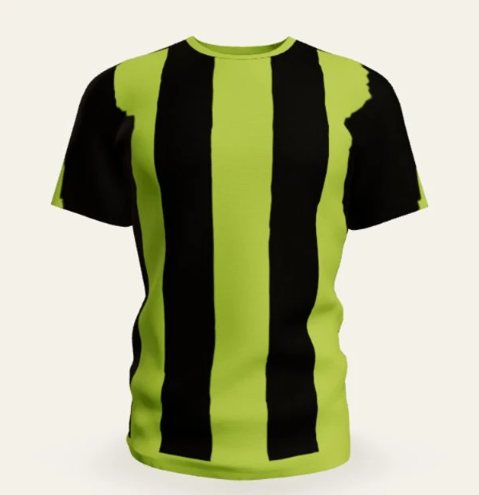
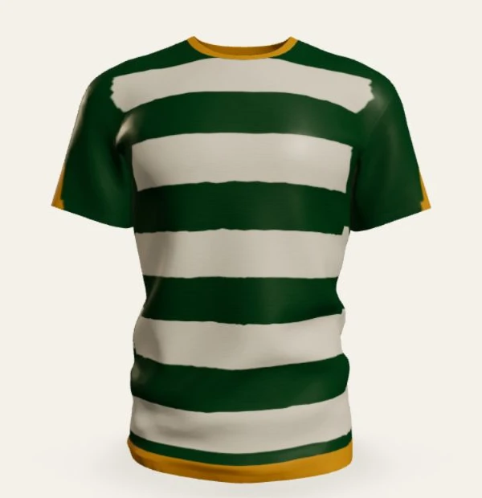
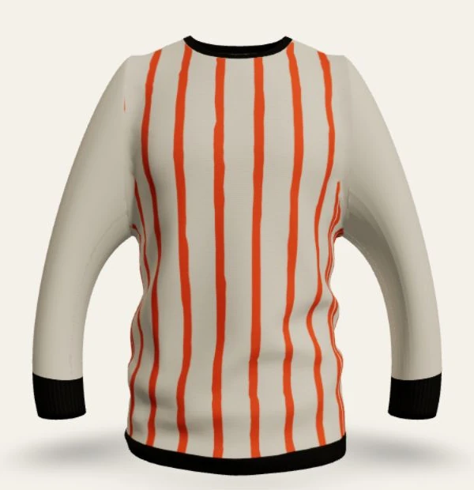

# KitStudio

### Design a complete team jersey in real time

KitStudio is a browser-based 3D jersey configurator built for teams, clubs, and kit suppliers. It combines live garment rendering, detailed visual customization, player personalization, roster management, pricing, and approval sharing in one responsive experience.

The application runs entirely in the browser. Designs are stored locally, and shareable configurations are encoded into versioned URLs without requiring an account or backend service.

| Volt FC | Forest Rovers | Ember Line |
| --- | --- | --- |
|  |  |  |

## Highlights

- Interactive 3D jersey preview with orbit controls, front/back views, camera presets, and multiple studio backgrounds
- Three garment fits: Pro Slim, Heritage Loose, and Pro Long Sleeve
- Fourteen patterns, fifteen curated presets, four editable color zones, and custom colors
- Crew, V-neck, polo, and mock-neck collar geometry
- Plain, single-band, double-band, and pattern-fade sleeve treatments
- Smooth, mesh, pique, and ribbed fabric finishes with matte or satin presentation
- Player name and number customization with font, color, style, scale, and position controls
- Front sponsor text and chest or sleeve logo placement
- Team roster for up to 25 players, including sizes and duplicate-number warnings
- Quantity-based BDT pricing with model, collar, and print add-ons
- Undo and redo history for design, print, and roster changes
- Local design library with import and export support
- Versioned share links and a read-only approval view
- PNG, SVG, editable KitStudio JSON, and self-contained HTML order-summary exports
- Responsive layouts, keyboard-accessible controls, reduced-motion support, and a WebGL fallback

## Tech stack

| Area | Technology |
| --- | --- |
| Application | React 19, TypeScript, React Router |
| Build tooling | Vite 8, Tailwind CSS 4 |
| 3D rendering | Three.js, React Three Fiber, Drei |
| Motion | Framer Motion, Maath |
| State | Zustand |
| Icons | Lucide React |
| Testing | Vitest |
| Linting | Oxlint |

## Getting started

### Requirements

- Node.js 20.19 or newer
- npm 10 or newer
- A modern browser with WebGL enabled for the full 3D experience

### Installation

```bash
git clone <repository-url>
cd KitStudio
npm install
```

### Development

```bash
npm run dev
```

Open [http://localhost:5173](http://localhost:5173) in your browser.

### Available scripts

| Command | Purpose |
| --- | --- |
| `npm run dev` | Start the Vite development server |
| `npm run build` | Type-check the project and create a production build |
| `npm run preview` | Preview the production build locally |
| `npm run lint` | Run Oxlint across the project |
| `npm test` | Run the Vitest test suite once |

## Application routes

| Route | Description |
| --- | --- |
| `/` | Marketing homepage, live 3D preview, preset collection, model comparison, workflow, and pricing |
| `/studio` | Full jersey configurator |
| `/studio?preset=<id>` | Open the Studio with a selected preset |
| `/studio?d=<payload>` | Open an editable design from a versioned share payload |
| `/gallery` | Saved designs and the preset gallery |
| `/approval?d=<payload>` | Read-only design, roster, and pricing approval view |
